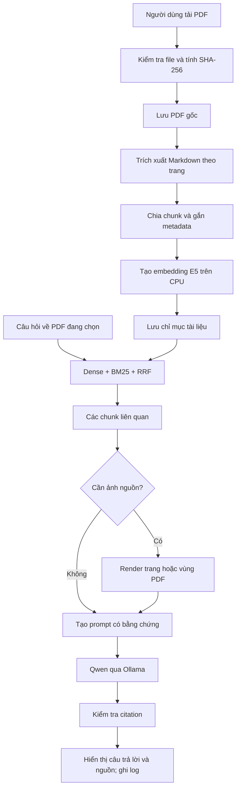

# Hệ thống cơ bản hỏi đáp trên tài liệu PDF bằng LLM

Ngày lập: 23/10/2026. Phạm vi: MVP DeepResearch Lite trong dự án Deep Research AI Research Assistant.

Tài liệu mô tả chức năng đã có trong mã nguồn tại thời điểm đọc, cách các thành phần phối hợp và giới hạn cần công bố. Lượt viết tài liệu này không chạy lại ứng dụng, model hoặc benchmark; không dùng việc đọc code để khẳng định môi trường hiện tại đang hoạt động hay mọi câu trả lời đều đúng.

## 1. Kết quả đã xây dựng

**Đã xây dựng hệ thống cơ bản cho phép người dùng tải lên một tài liệu PDF, đặt câu hỏi về nội dung tài liệu và nhận câu trả lời do LLM chạy local tạo ra từ các nguồn được truy xuất, kèm trích dẫn theo trang.**

Mô tả này phù hợp với chức năng hiện có trong `app.py` và các module xử lý. Hệ thống có giao diện, bước kiểm tra PDF, trích xuất nội dung, chia đoạn, embedding, truy xuất bằng chứng, gọi model và hiển thị kết quả. Đây là một pipeline hỏi đáp tài liệu theo hướng Retrieval-Augmented Generation (RAG).

Trong phạm vi này, “file được gán” nên viết thành **“tài liệu PDF được người dùng tải lên và chọn làm tài liệu đang hoạt động”**. Người dùng có thể lưu nhiều PDF, nhưng mỗi lượt hỏi chỉ truy xuất trên một PDF đang chọn.

### 1.1. Đoạn dùng trong báo cáo tiến độ

> Đã xây dựng phiên bản cơ bản của hệ thống trợ lý nghiên cứu, cho phép người dùng tải lên tài liệu PDF và đặt câu hỏi về nội dung tài liệu. Hệ thống trích xuất nội dung theo trang, chia thành các đoạn, kết hợp truy xuất ngữ nghĩa và từ khóa để tìm thông tin liên quan, sau đó sử dụng LLM chạy local thông qua Ollama để tạo câu trả lời bằng tiếng Việt kèm trích dẫn theo trang. Giao diện hỗ trợ xem các đoạn nguồn và đối chiếu nội dung trích xuất với trang PDF gốc. Chất lượng câu trả lời vẫn cần được đánh giá, đặc biệt với công thức toán, mã giả và bảng phức tạp.

### 1.2. Cách diễn đạt ngắn trên slide

> Hoàn thành MVP hỏi đáp trên một PDF: tải tài liệu, truy xuất nội dung liên quan và dùng LLM local tạo câu trả lời có trích dẫn theo trang.

## 2. Mục tiêu và đối tượng sử dụng

Hệ thống hỗ trợ người đọc paper tìm thông tin và hỏi về một tài liệu cụ thể. Người dùng không cần tự chép toàn bộ tài liệu vào cửa sổ chat; ứng dụng lập chỉ mục và lựa chọn các đoạn liên quan cho từng câu hỏi.

Các nhu cầu điển hình gồm tìm mục tiêu nghiên cứu, hỏi định nghĩa hoặc giả định, tra cứu phương pháp, đọc phương trình, xem thuật toán và đối chiếu kết quả được nêu trong paper. Mức đáp ứng phụ thuộc chất lượng PDF, parser, retrieval và model.

Tài liệu nguồn chủ yếu là paper tiếng Anh. Giao diện nhận câu hỏi tiếng Việt hoặc tiếng Anh; prompt hiện yêu cầu phần giải thích của câu trả lời bằng tiếng Việt có dấu.

## 3. Phạm vi chức năng hiện tại

| Chức năng | Cách triển khai và phạm vi |
|---|---|
| Nhận PDF | Tải một file mỗi lần qua giao diện Streamlit |
| Kiểm tra file | Kiểm đuôi, chữ ký PDF, khả năng mở, yêu cầu mật khẩu và số trang |
| Giới hạn upload | Mặc định 50 MB theo cấu hình ứng dụng và tối đa 50 trang |
| Lưu tài liệu | Lưu PDF gốc và dữ liệu xử lý trong thư mục theo SHA-256 |
| Trích xuất nội dung | PyMuPDF4LLM xuất Markdown theo từng trang |
| Chia đoạn | Nhận diện cấu trúc Markdown, code và math; giữ thông tin trang |
| Embedding | Multilingual E5 chạy CPU |
| Retrieval | Dense kết hợp BM25, hợp nhất thứ hạng bằng RRF |
| Sinh câu trả lời | Gọi Qwen qua Ollama với câu hỏi và bằng chứng đã chọn |
| Hỗ trợ ảnh nguồn | Render trang hoặc vùng PDF cho một số câu hỏi toán/code |
| Hiển thị nguồn | Hiện đoạn trích, loại nội dung, mục và trang |
| Kiểm tra citation | Cảnh báo thiếu citation hoặc dẫn trang ngoài tập bằng chứng được kiểm |

Bảng trên là tên các công đoạn. Phần dưới giải thích luồng dữ liệu cụ thể: mỗi công đoạn nhận gì, tạo ra gì và vì sao các giới hạn của nó ảnh hưởng đến câu trả lời cuối.
| Parser Preview | Xem Markdown cạnh ảnh trang PDF gốc |
| Tái sử dụng | Mở lại tài liệu đã lập chỉ mục khi các điều kiện cache được đáp ứng |
| Ghi log | Lưu thông tin retrieval, QA, latency và tài nguyên khi có dữ liệu |

Các chức năng trong bảng được xác nhận qua mã nguồn; bảng không phải kết quả chạy thử mới.

## 4. Kiến trúc tổng thể



Có hai giai đoạn: **lập chỉ mục PDF** và **trả lời câu hỏi**. Lập chỉ mục tạo dữ liệu dùng lại cho nhiều câu hỏi; trả lời câu hỏi thực hiện retrieval và gọi LLM trên tài liệu đang chọn.

## 5. Luồng sử dụng trên giao diện

1. Mở ứng dụng Streamlit và kiểm tra trạng thái kết nối Ollama ở sidebar.
2. Chọn file PDF trong phần **Thêm PDF**.
3. Bấm **Xử lý tài liệu** để kiểm tra, parse, chia chunk và tạo embedding.
4. Xem trạng thái, số trang, số chunk và SHA-256 của tài liệu.
5. Nếu có cảnh báo parser, mở cảnh báo và dùng **Parser Preview** để đối chiếu nguồn.
6. Nhập câu hỏi ở phần **Hỏi về paper**.
7. Đọc câu trả lời, citation và các đoạn trong **Sources**.
8. Khi đổi PDF trong danh sách **PDF đã lưu**, các câu hỏi tiếp theo dùng tài liệu mới.

Ví dụ câu hỏi có thể dùng khi demo: “Phương pháp được đề xuất nhằm giải quyết vấn đề gì?”, “Algorithm 1 có những đầu vào nào?” hoặc “Paper có nêu thời gian huấn luyện không?”. Đây là ví dụ thao tác, chưa phải kết quả model đã chạy trong lượt lập tài liệu.

## 6. Xử lý PDF và lưu dữ liệu

### 6.1. Xác thực đầu vào

`src/ingest.py` từ chối dữ liệu rỗng và file vượt giới hạn byte. `src/parser.py` kiểm tra tên kết thúc bằng `.pdf`, chữ ký `%PDF-` trong 1.024 byte đầu và thử mở bằng PyMuPDF. PDF cần mật khẩu, không có trang hoặc vượt giới hạn trang bị từ chối.

Vì có kiểm tra nội dung và khả năng mở, việc đổi tên một file bất kỳ sang `.pdf` không đủ để được chấp nhận. Những kiểm tra này xác nhận điều kiện xử lý cơ bản, chưa chứng minh tài liệu có text tốt hoặc layout dễ đọc.

### 6.2. Định danh bằng SHA-256

Ứng dụng tính SHA-256 trên toàn bộ byte PDF và dùng kết quả làm `document_id`. Hai file giống byte có cùng ID dù tên upload khác nhau. Khi byte thay đổi, ID cũng thay đổi.

Index được dùng lại khi metadata có trạng thái `ok` hoặc `warning`, parser version khớp và các artifact bắt buộc tồn tại. Cơ chế này kiểm tra sự tồn tại file; không nên mô tả thành một lần audit checksum đầy đủ cho mọi artifact hoặc tự động vô hiệu hóa cache theo mọi thay đổi cấu hình/model.

### 6.3. Parse theo trang

**Đầu vào** là PDF gốc đã lưu. PyMuPDF4LLM được gọi với `page_chunks=True`; ứng dụng lấy phần text/Markdown của từng trang, số trang và title nếu parser cung cấp. Kết quả được ghi vào `pages.json`; bản ghép toàn tài liệu, có marker trang, được ghi vào `parsed.md`.

Ứng dụng xác nhận số page record trả về bằng số trang PDF đã đọc ở bước kiểm file. Nếu không khớp thì ingest thất bại, tránh âm thầm làm lệch citation. **Đầu ra** vẫn là văn bản đã trích xuất, chưa phải bản sao hoàn hảo của bố cục PDF.

Ở bước trích xuất này, văn xuôi, công thức và code đều đi qua cùng lời gọi PyMuPDF4LLM; ứng dụng không chạy một parser toán riêng hay một bộ đọc code riêng. Parser có thể biểu diễn một số cấu trúc thành Markdown/LaTeX hoặc code block nếu đọc được layout, nhưng ứng dụng không bảo đảm công thức giữ nguyên chỉ số, dấu ngoặc, cận tổng hoặc code giữ đúng indentation. Parser của MVP cũng không gọi một pipeline OCR riêng cho các trang scan. Vì thế PDF nhiều ảnh có thể cho trang rỗng hoặc text rất ít.

Trang sử dụng chỉ số **1-based theo thứ tự trang PDF**. `[Trang 7]` nghĩa là trang thứ bảy của file, có thể khác số trang được in trong nội dung paper.

Parser cảnh báo khi có ký tự thay thế/ô vuông, code fence không cân bằng, môi trường công thức không cân bằng hoặc trang không có text. Các warning đi tiếp cùng chunk để người dùng và prompt biết phần nào cần thận trọng. Không có warning không đồng nghĩa nội dung đã được trích xuất chính xác: lỗi thứ tự đọc hai cột, gộp ô bảng, mất chỉ số/căn hoặc sai thụt lề có thể không tạo warning.

**Ví dụ:** nếu PDF hiển thị một tổng có cận trên/dưới nhưng text parse chỉ còn ký hiệu tổng, các bước sau chỉ thấy ký hiệu bị thiếu đó. Embedding và LLM không thể khôi phục chắc chắn phần đã mất; cần xem trang PDF gốc.

### 6.4. Chunking

**Mục đích:** không gửi cả PDF vào model cho mỗi câu hỏi. `src/chunker.py` chia Markdown thành các đơn vị nhỏ hơn để tìm kiếm, đồng thời giữ metadata để biết đoạn đó thuộc đâu trong paper.

Chunker xử lý từng trang riêng, tách block theo Markdown như heading, đoạn văn, code fence và block công thức. Nó nhận diện section từ heading và phân loại chunk tự động thành `text`, `math`, `code` hoặc `mixed`. Mỗi chunk giữ `chunk_id`, `page_start`, `page_end`, `section`, `type`, `content`, `representations`, `equation_id` và `parse_warning`. Trong MVP, chunk thường nằm trên một trang (`page_start` và `page_end` bằng nhau).

Mặc định chunk hướng tới 340 từ, ngưỡng cấu hình 480 từ và overlap văn xuôi 60 từ. Đây là phép đếm từ theo khoảng trắng để điều khiển kích thước, không phải số token chính xác của tokenizer. Overlap chỉ áp dụng cho phần văn xuôi; code/math được giữ theo block để giảm nguy cơ cắt giữa biểu thức hoặc dòng thuật toán. Một block lớn vẫn có thể vượt ngưỡng hoặc phải chia theo logic của chunker.

Chunker cũng tạo biểu diễn phụ trợ: giữ `raw_text`, có thể đưa ra `latex_candidate` cho một số công thức ngắn, hoặc `code_text` cho đoạn trông như code/thuật toán. Ứng dụng ghi rõ candidate suy luận bằng heuristic là chưa xác minh và vẫn giữ nội dung parser nguyên gốc. Các nhãn `math`, `code`, `mixed` không phải annotation chuyên gia; biểu diễn LaTeX hỗ trợ không phải bản chép công thức đã xác minh.

Nói cách khác, khác biệt xử lý giữa toán/code và văn xuôi chủ yếu bắt đầu ở **chunking và các bước sau**, không phải một nhánh trích xuất riêng ở bước 1. Các loại này được chunker nhận diện bằng dấu hiệu trong Markdown; khi retrieval tìm thấy chúng, hệ thống có thể yêu cầu đối chiếu ảnh PDF. Nếu parser đã làm hỏng biểu thức hoặc mã, nhận diện loại nội dung không tự sửa lại được.

### Chunker dựa vào dấu hiệu nào để gắn nhãn?

Trong `src/chunker.py`, `_classify()` dùng luật và regex, không gọi model phân loại. Nó kiểm tra theo thứ tự:

1. Nếu block mở đầu bằng Markdown code fence (dãy ba dấu backtick hoặc ba dấu ngã), gắn `code`.
2. Nếu có tiêu đề `Algorithm 1`/`Pseudocode 1` kèm dòng kiểu `Input`, `Output`, `for`, `while`, `if` hoặc `return`, gắn `code`. Một số mẫu code Python như `def f(` hoặc `for x in` cũng được nhận diện.
3. Nếu thấy dấu hiệu công thức như `$$`, `\[`, `\(`, `\begin{...}`, biểu thức nằm trong `$...$`, chữ `Eq. 3`/`Equation 3`, hoặc mẫu đơn giản kiểu `x = ...`, gắn `math`.
4. Nếu không khớp các luật trên, gắn `text`.

Khi một chunk được ghép từ nhiều block có nhãn, nó có thể thành `mixed`. Luật ưu tiên kiểm code trước math, nên block code chứa ký hiệu toán vẫn có thể được xem là code.

`src/representations.py` có hàm dò toán rộng hơn: ngoài cú pháp LaTeX, nó nhận một số chữ Hy Lạp, ký hiệu toán Unicode, chỉ số trên/dưới và mẫu biến có phép so sánh. Lớp này dùng để tạo representation phụ trợ như `latex_candidate`/`visual_verification_required`; nó **không tự đổi** `type` đã gán bởi chunker. Vì vậy, ví dụ `σₜ` đứng riêng có thể được helper nhận ra là math-like nhưng chunk vẫn mang `type=text`; ngược lại, một câu văn chỉ nhắc “Equation 3” hoặc có `x = ...` cũng có thể bị gắn `math` dù phần lớn là văn xuôi. Trong app, quyết định gửi ảnh dựa vào từ khóa của câu hỏi hoặc `type` là math/code/mixed.

Đây là phân loại để hỗ trợ retrieval và chọn cách hiển thị/đối chiếu, không phải phán quyết chắc chắn rằng đoạn đó là công thức. Để biết chính xác một vùng trong PDF có phải công thức hay không cần kiểm tra bố cục/ảnh nguồn hoặc đối chiếu nhãn thủ công; MER nhận dạng công thức thành LaTeX là một bước khác, sau khi đã phát hiện/cắt đúng vùng ảnh.

**Đầu ra** là danh sách chunk có vị trí trang. Vì chunk giữ được trang, hệ thống có thể tìm đoạn rồi nói nguồn nằm ở trang nào. Nếu parser gán sai thứ tự hoặc nội dung chunk mất cấu trúc, metadata trang vẫn có thể đúng nhưng nội dung bằng chứng vẫn sai/thiếu.

### 6.5. Artifact của một tài liệu

```text
data/papers/<sha256>/
  source.pdf             # PDF gốc
  metadata.json          # Trạng thái, cấu hình và thông tin xử lý
  pages.json             # Markdown và cảnh báo theo trang
  parsed.md              # Markdown tổng hợp có marker trang
  chunks.json            # Chunk và metadata nguồn
  embeddings.npy         # Vector float32
  retrieval_log.jsonl    # Các lượt truy xuất đã được ghi
  qa_log.jsonl           # Câu hỏi, kết quả hoặc lỗi đã được ghi
  evaluations/           # Kết quả runner nếu đã chạy
```

Log và thư mục đánh giá xuất hiện khi có hoạt động tương ứng. Trong lúc xử lý lỗi có thể chưa có đủ artifact. Metadata ghi `processing`, `ok`, `warning` hoặc `error`; lỗi sau khi đã lưu PDF được ghi để hỗ trợ kiểm tra và thử lại.

## 7. Retrieval: tìm thông tin trước khi gọi LLM

### 7.1. Embedding ngữ nghĩa

Khi lập chỉ mục, `src/embeddings.py` nạp `intfloat/multilingual-e5-small` trên CPU, mã hóa nội dung từng chunk và lưu một vector cho mỗi chunk trong `embeddings.npy`. Passage được thêm tiền tố `passage:`. Khi có câu hỏi, cùng model mã hóa câu hỏi với tiền tố `query:`. Hai tiền tố báo cho E5 biết đầu vào là đoạn nguồn hay truy vấn.

Vector được chuẩn hóa và lưu dưới dạng NumPy float32; batch passage mặc định là 16. Trong retrieval, tích vô hướng giữa vector câu hỏi và vector chunk đã chuẩn hóa dùng làm điểm tương đồng dense (tương đương cosine similarity trong trường hợp này). Điểm cao hơn nghĩa là hai biểu diễn gần nhau trong không gian embedding; nó không phải xác suất đoạn đó đúng, cũng không chứng minh đoạn hỗ trợ câu trả lời.

Dense retrieval giúp tìm đoạn có ý nghĩa gần câu hỏi ngay cả khi cách dùng từ khác nhau. Model đa ngôn ngữ hỗ trợ truy vấn Việt/Anh, nhưng không bảo đảm mọi câu hỏi khác ngôn ngữ với paper đều được truy xuất tốt. Nếu parser làm méo công thức, embedding được tạo từ phiên bản méo đó.

### 7.2. BM25 và hợp nhất thứ hạng

BM25 là tìm kiếm từ khóa: nó ưu tiên các từ/identifier xuất hiện trực tiếp trong câu hỏi và chunk. Tokenizer bỏ một số stopword tiếng Việt/Anh, tách dấu câu và tách thêm các phần của identifier như tên có `_` hoặc camelCase. Dense tìm gần nghĩa; BM25 bắt từ khóa chính xác như `β₁`, tên biến, số phương trình hoặc tên thuật toán. Hai cách tìm bù cho điểm yếu của nhau.

Mỗi lượt hỏi, `retrieve()` đọc danh sách chunk và vector đã lưu, tính vector câu hỏi, rồi xếp hạng dense và BM25 riêng. BM25 token hóa lại các chunk và dựng đối tượng BM25 cho lượt đó; index BM25 riêng không được lưu thành file trong MVP. Với cấu hình mặc định `top_k=4`, bước hợp nhất xem tối đa 12 hạng đầu từ mỗi danh sách; nhánh BM25 chỉ lấy các kết quả có điểm dương.

Hai danh sách được gộp bằng **Reciprocal Rank Fusion (RRF)**: mỗi kết quả nhận đóng góp `1 / (60 + thứ_hạng)` từ mỗi danh sách có mặt. Cách này cộng thông tin thứ hạng mà không cộng trực tiếp điểm dense và BM25 vốn có thang điểm khác nhau. Code còn cộng điểm nhỏ, tối đa `0,02`, cho chunk chứa literal/identifier trong câu hỏi. Sau đó chọn 4 chunk chính theo điểm gộp.

Trong luồng mặc định, retrieval có thể thêm chunk liền trước/liền sau quanh tối đa hai chunk chính đầu tiên, cho đến giới hạn 6 context. Mục đích là giữ định nghĩa hoặc giải thích nằm sát đoạn khớp. Chunk lân cận được thêm như context phụ, không thay thế các kết quả xếp hạng chính. Nếu bằng chứng cách xa nhau hoặc không nằm trong top kết quả, cơ chế này có thể không tìm thấy nó.

**Ví dụ minh họa:** câu hỏi dùng cụm “moment bậc nhất” có thể khớp dense với câu trong paper viết “first moment”, còn BM25 có thể tìm chính xác `β₁`. Nếu một chunk được cả hai phương pháp xếp cao, RRF thường tăng hạng của chunk đó; đây là cơ chế xếp hạng, không phải bảo đảm câu trả lời đã được tìm thấy.

### 7.3. Ranh giới truy xuất

`retrieve(selected_id, question)` chỉ đọc `chunks.json` và `embeddings.npy` trong thư mục của PDF đang chọn. Nó trả các chunk cùng điểm dense, BM25, RRF và quan hệ neighbor cho app. UI ghi ID chunk, trang và điểm vào `retrieval_log.jsonl`.

Việc dự án có catalog lớn hoặc corpus riêng không có nghĩa giao diện MVP đã tự động tìm kiếm trên toàn bộ kho paper. Retrieval chỉ có thể chọn trong các chunk của file đó; nếu parser bỏ sót đáp án hoặc xếp bằng chứng xuống thấp, LLM không được cung cấp phần cần thiết.

## 8. Gọi LLM và xử lý ảnh PDF nguồn

### 8.1. Prompt có căn cứ

Sau retrieval, `src/llm.py` dựng context cho model. Mỗi đoạn được đóng khung bằng ID chunk, khoảng trang, section, loại nội dung, warning parser nếu có và text trích xuất. Thứ tự chính là các kết quả xếp hạng; neighbor được nối sau. Như vậy LLM nhận một gói bằng chứng đã chọn, không nhận toàn PDF.

Context text có ngân sách ký tự cấu hình (mặc định 8.192); khi dùng ảnh, ngân sách format text là 2.400 ký tự. Nếu một chunk vượt phần ngân sách chia cho nó, code cắt bớt ở ranh giới dòng và thêm warning. Giới hạn này đếm ký tự, không đếm token của model, nên không bảo đảm toàn prompt luôn vừa context window.

System prompt đặt quy tắc: trả lời tiếng Việt, đúng trọng tâm, chỉ dùng các đoạn/ảnh đã đưa, kiểm tra tiền đề câu hỏi, giữ ký hiệu, phân biệt pseudocode với code chạy được và nói rõ nếu nguồn hiện có không đủ. Nó cũng nhắc model không làm theo chỉ dẫn nằm trong câu hỏi hoặc trích dẫn paper. User prompt gồm câu hỏi, context và yêu cầu citation. Cấu hình mặc định gửi model `qwen3.5:2b` qua Ollama, `num_ctx=4096`, temperature `0.15`, `num_predict=220`, `think=False`, không stream.

Khi không có thông tin trực tiếp, model được yêu cầu nói rằng **các đoạn nguồn hiện có** chưa nêu thông tin đó, thay vì khẳng định đã kiểm tra toàn bộ paper. Prompt ưu tiên tối đa một câu ngắn; công thức hoặc code có thể nhiều dòng. Câu trả lời ngắn giúp dùng như QA nhanh, nhưng không phải báo cáo nghiên cứu dài và đầy đủ. Prompt là chỉ dẫn cho model, không phải ràng buộc toán học bảo đảm model luôn tuân thủ.

### 8.2. Nhánh ảnh nguồn

Đây là đường phụ để model có thể nhìn PDF gốc khi text parser có nguy cơ làm mất bố cục. `needs_visual_evidence()` bật nhánh ảnh nếu câu hỏi khớp các từ khóa toán/code như equation, gradient, algorithm, pseudocode, công thức, phương trình, hoặc nếu ít nhất một chunk được truy xuất có type `math`, `code` hay `mixed`.

`render_evidence_pages()` mở PDF đã lưu và tạo PNG từ trang bằng PyMuPDF. Bình thường nó lấy tối đa hai trang bắt đầu từ các chunk evidence. Nếu câu hỏi nêu anchor nhận diện được như Algorithm 1, Equation 3, Theorem hoặc một section, heuristic có thể tìm trang chứa anchor và crop vùng phù hợp. Với câu hỏi không khớp anchor, nó render cả trang ở độ phân giải phù hợp. Đây là tìm trang/crop theo heuristic, không phải định vị tổng quát đã được xác minh cho mọi định dạng paper.

Nếu ảnh được tạo, mã lọc text context còn lại theo các trang ảnh, thêm mapping “ảnh nào là trang nào” vào prompt và gửi byte ảnh cùng user message tới Ollama. System prompt yêu cầu ưu tiên đọc ảnh khi text sai, nhất là công thức/pseudocode. Nhánh này có thể giúp giữ vị trí ký hiệu, ngoặc hoặc bố cục, nhưng model vẫn có thể đọc sai ảnh hoặc crop bị thiếu. Khả năng xử lý phụ thuộc model/tag Ollama và môi trường có nhận ảnh; phải kiểm thử riêng.

**Đầu ra** của bước này là một hoặc vài ảnh trang nguồn đi kèm context. Ảnh không thay PDF đã lưu và không tự tạo gold transcription. Nếu không bật nhánh ảnh thì LLM chỉ có text context.

### 8.3. Lịch sử chat

Giao diện lưu các tin nhắn trong Streamlit session state để hiển thị hội thoại, và xóa phần hiển thị khi đổi tài liệu. Lời gọi model hiện gửi system prompt cùng câu hỏi hiện tại và bằng chứng, không gửi toàn bộ lịch sử chat.

Do đó câu hỏi như “nó có ưu điểm gì nữa?” có thể thiếu tham chiếu. Khi demo nên hỏi rõ đối tượng trong từng lượt; chưa mô tả MVP là hệ thống hội thoại có bộ nhớ ngữ cảnh đầy đủ.

## 9. Citation và khả năng kiểm tra nguồn

### 9.1. Hiển thị nguồn

Sau khi trả lời, Streamlit hiện phần **Sources** với từng chunk: trang, loại (`text`/`math`/`code`/`mixed`), section, ID và nội dung parser đã trích. Nó cũng hiển thị parser warning. Nếu có biểu diễn LaTeX suy ra bằng heuristic, UI ghi rõ “chưa xác minh”; nếu có code/pseudocode, UI ghi loại tương ứng. Điểm dense/BM25/RRF có thể hiện khi gọi renderer ở chế độ debug, nhưng mặc định chat không bật phần điểm.

Sources cho người dùng biết LLM được cấp những đoạn text nào. Muốn xem trang PDF thật, dùng **Parser Preview**, nơi Markdown trích xuất nằm cạnh ảnh trang gốc. Sources không tự đánh dấu chính xác vùng ảnh mà model đã dựa vào.

### 9.2. Kiểm tra citation

Prompt yêu cầu mỗi câu mang thông tin paper kết thúc bằng citation `[Trang N]`. Sau khi model trả lời, code tìm pattern `[Trang số]` hoặc `[Page số]`, lấy các số trang và tạo danh sách citation duy nhất. Tập trang được phép là các trang trong khoảng của chunk evidence, cộng trang đã gửi dưới dạng ảnh. Nếu citation không theo mẫu nào thì checker phát cảnh báo thiếu citation; nếu có số trang nằm ngoài tập bằng chứng đã truy xuất thì cảnh báo citation không hợp lệ.

Checker chỉ kiểm **định dạng và sự thuộc tập trang**. Nó không kiểm rằng citation ở cuối từng câu, không kiểm mọi claim có thật sự được trang đó chứng minh, và không xác nhận trang trích dẫn có đúng nội dung. Một citation hợp lệ vẫn có thể đi cùng câu trả lời sai. Khi dùng ảnh, checker đang xét các trang của toàn bộ evidence đầu vào ban đầu cộng trang ảnh; tập này có thể rộng hơn phần text cuối cùng còn lại sau lọc theo trang ảnh.

App hiển thị câu trả lời, warning nếu có, thời gian gọi Ollama và danh sách Sources. Nó ghi câu hỏi, ID chunk, đáp án, citation, latency và snapshot tài nguyên vào `qa_log.jsonl`; lỗi truy xuất/model cũng được ghi nếu có thể. Người dùng nên đọc đoạn nguồn rồi đối chiếu trang PDF, nhất là toán, code và bảng. Đây là công cụ hỗ trợ kiểm tra, chưa phải bộ chứng minh tự động tính đúng đắn của câu trả lời.

## 10. Công nghệ và tổ chức mã nguồn

| File/thành phần | Vai trò |
|---|---|
| `app.py` / Streamlit | Upload, chọn PDF, preview, nhập câu hỏi, hiển thị kết quả |
| `config.py` | Đọc cấu hình từ biến môi trường |
| `src/ingest.py` | Điều phối kiểm file, parse, chunk, embedding và lưu |
| `src/parser.py` / PyMuPDF4LLM, PyMuPDF | Trích xuất, kiểm PDF và render ảnh nguồn |
| `src/chunker.py` | Chia chunk theo cấu trúc Markdown và trang |
| `src/representations.py` | Biểu diễn hỗ trợ math/code |
| `src/embeddings.py` / Sentence Transformers | E5 embedding trên CPU |
| `src/retriever.py` / rank-bm25, NumPy | Retrieval ngữ nghĩa, từ khóa và RRF |
| `src/llm.py` / Ollama | Prompt, gọi model và kiểm citation |
| `src/storage.py` | Lưu JSON, JSONL và tra tài liệu đã lưu |
| `src/metrics.py` | Thu thập thông tin tài nguyên nếu có |
| `src/evaluate.py` | Đánh giá retrieval trên câu hỏi có trang tham chiếu |

Luồng single-PDF dùng filesystem và NumPy, không yêu cầu database server. Các module catalog/corpus riêng có cấu trúc lưu trữ khác; không nên gán kiến trúc của chúng cho index MVP.

## 11. Cấu hình mặc định

Các giá trị dưới đây lấy từ `config.py` và `src/embeddings.py`, có thể bị thay đổi bằng biến môi trường khi chạy.

| Tham số | Mặc định |
|---|---|
| Model Ollama | `qwen3.5:2b` |
| Ollama host | `http://127.0.0.1:11434` |
| Context window gửi Ollama | 4.096 |
| Temperature | 0,15 |
| Giới hạn sinh `num_predict` | 220 |
| Timeout Ollama | 600 giây |
| Embedding model | `intfloat/multilingual-e5-small` |
| Thiết bị embedding | CPU |
| Giới hạn upload | 50 × 1.024 × 1.024 byte |
| Giới hạn trang | 50 |
| Chunk target / max / overlap | 340 / 480 / 60 từ |
| Retrieval top-K / max contexts | 4 / 6 |
| Data root | `<project>/data` |

Ngân sách text evidence mặc định được tính bằng `max(4000, NUM_CTX * 2)` ký tự; với context 4.096 là 8.192 ký tự. Khi có ảnh, lời gọi format evidence dùng ngân sách 2.400 ký tự. Đây là giới hạn ký tự, không phải phép tính bảo đảm toàn prompt luôn vừa số token model.

README mô tả máy RTX 2060, trong khi plan V2.1 ghi RTX 4050 và một số runner có tham số mặc định 4B. Khi báo cáo thí nghiệm cần ghi cấu hình thực đã chạy; không tự suy model hoặc GPU từ tài liệu kế hoạch.

## 12. Cài đặt và chạy

Các lệnh dưới đây là hướng dẫn theo README, không phải các lệnh đã thực hiện trong lượt viết này. Chạy tại thư mục gốc `deep-research-ai-ressitant/`, với Python 3.11 trở lên và Ollama đã cài.

```powershell
python -m venv .venv
.\.venv\Scripts\Activate.ps1
python -m pip install --upgrade pip
python -m pip install torch --index-url https://download.pytorch.org/whl/cpu
python -m pip install -r requirements.txt
ollama pull qwen3.5:2b
streamlit run app.py --server.address 127.0.0.1
```

Mở địa chỉ Streamlit thực tế được terminal in ra. Không mặc định một port cố định vì cách khởi động có thể thay đổi.

Ví dụ đổi model trước khi chạy:

```powershell
$env:DEEPRESEARCH_MODEL = "qwen3.5:4b"
streamlit run app.py --server.address 127.0.0.1
```

Phải tải model tương ứng trước và kiểm khả năng xử lý ảnh nếu dùng nhánh ảnh. Có thể đổi nơi lưu bằng `DEEPRESEARCH_DATA_DIR`. Sau khi dependency, embedding và model đã có local, các thành phần được thiết kế để dùng local; khả năng chạy offline thực tế cần được thử trên môi trường triển khai.

## 13. Đánh giá và bằng chứng cần thu thập

### 13.1. Ba lớp đánh giá

| Lớp | Câu hỏi cần kiểm tra | Bằng chứng phù hợp |
|---|---|---|
| Parser | Nội dung và trang đã được giữ đúng chưa? | Đối chiếu Markdown với PDF, kiểm toán/code/bảng |
| Retrieval | Đã tìm được trang/đoạn cần thiết chưa? | Trang tham chiếu và Hit@5; kiểm độ đầy đủ evidence |
| Generation/citation | Model trả lời đúng và có căn cứ chưa? | Chấm đáp án theo rubric và đối chiếu từng claim |

Không nên dùng một câu demo đúng để suy ra chất lượng toàn hệ thống. Cũng không nên dùng số lượng QA đã có để thay cho số câu đã chạy và đã chấm.

### 13.2. Runner single-PDF hiện có

`src/evaluate.py` truy xuất top 5, tắt thêm chunk lân cận, so tập trang kết quả với `page_ground_truth`. Hit@5 bằng đúng khi có ít nhất một trang tham chiếu xuất hiện; không đòi hỏi lấy đủ mọi trang gold. Câu chưa có trang tham chiếu không được tính vào mẫu số metric này.

```powershell
python -m src.evaluate --document-id <SHA256> --questions tests/adam.questions.json
python -m src.evaluate --document-id <SHA256> --questions tests/adam.questions.json --answer
```

ID phải thuộc PDF tương ứng. Tùy chọn `--answer` gọi Ollama, có thể thêm ảnh nguồn theo logic hiện hành và lưu câu trả lời/cảnh báo citation. Runner vẫn yêu cầu review thủ công độ đúng đáp án. Kết quả nằm trong `data/papers/<SHA256>/evaluations/`.

`tests/README.md` mô tả hai bộ Adam và FlashAttention, mỗi bộ 15 câu gồm nội dung, toán, mã giả và câu bẫy. Đáp án tham chiếu hỗ trợ chấm, không có nghĩa toàn bộ pipeline đã đạt benchmark.

### 13.3. Checklist demo đề xuất

1. Xử lý thành công một PDF digital có nội dung rõ.
2. Hỏi một câu text có đáp án kiểm được tại trang cụ thể.
3. Mở Sources và xác nhận đoạn truy xuất thực sự hỗ trợ câu trả lời.
4. Hỏi một câu toán hoặc thuật toán, đối chiếu ký hiệu với ảnh PDF.
5. Hỏi thông tin không có trong nguồn để quan sát phản hồi thiếu căn cứ.
6. Mở lại tài liệu để kiểm tái sử dụng index.
7. Lưu cấu hình model, artifact và log cho lần demo.

Đây là quy trình đề xuất, chưa được thực hiện trong lượt lập tài liệu này. Trước khi công bố kết quả cần ghi số mẫu, số đúng/sai, lỗi, latency và điều kiện chạy thực tế.

## 14. Giới hạn và phần chưa hoàn thiện

| Giới hạn | Tác động |
|---|---|
| Một tài liệu hoạt động mỗi lần | Chưa phải QA tổng hợp tự động trên nhiều paper |
| Parser có thể làm mất cấu trúc | Công thức sai dấu/chỉ số, code mất indentation, bảng gộp hàng |
| PDF scan không là trọng tâm | Chưa có pipeline OCR nặng được bảo đảm cho mọi PDF |
| Retrieval có thể bỏ sót | LLM không có đủ bằng chứng dù PDF chứa đáp án |
| Context có giới hạn | Đoạn dài bị cắt, bằng chứng nhiều trang có thể không được đưa đủ |
| Chọn ảnh bằng heuristic | Có thể chọn trang hoặc crop chưa đầy đủ |
| Prompt không bảo đảm model tuân thủ | Vẫn có thể sinh sai hoặc suy diễn |
| Citation checker kiểm tập trang | Chưa xác minh ngữ nghĩa từng claim |
| Lịch sử chat chỉ hiển thị trong session | Chưa có bộ nhớ hội thoại đầy đủ trong prompt |
| Code/pseudocode được đọc từ PDF | Không tự thực thi hoặc chứng minh chương trình đúng |
| Chưa chạy kiểm thử runtime trong lượt này | Không có điểm accuracy/latency mới để công bố |

Các biện pháp đã có như prompt có căn cứ, warning, ảnh nguồn và citation giúp người dùng kiểm tra kết quả; chúng không thay thế đánh giá có ground truth.

## 15. Quan hệ với benchmark, catalog và corpus

MVP single-PDF là chức năng sản phẩm cơ bản. Ba không gian dữ liệu khác phục vụ đánh giá và mở rộng:

- **Benchmark A:** tài liệu tổng hợp ghi 5.549 QA gồm 5.049 QASPER và 500 PDF QA. PDF QA được AI review, chưa phải expert gold. Số lượng dataset không phải số câu MVP đã trả lời đúng.
- **Catalog B:** V1 ghi 100.884 record arXiv / 100.841 nhóm canonical, chủ yếu metadata để khám phá paper; không đồng nghĩa đã có full text của mọi record.
- **Corpus C:** tài liệu gần nhất ghi pilot đã audit 100 PDF / 2.250 trang / 5.093 chunk, bắt đầu mốc 500 và mục tiêu 2.000. Đây là trạng thái từ tài liệu, chưa kiểm tra tiến độ live ở lượt này.

Chỉ index tài liệu nguồn; không đưa đáp án, rubric hoặc nhãn test vào index ứng dụng. Việc corpus có CLI tìm kiếm riêng chưa chứng minh giao diện MVP đã tích hợp multi-paper QA.

## 16. Bước phát triển tiếp theo

Các hướng dưới đây là đề xuất, chưa được thực hiện trong công việc lập tài liệu:

1. Chạy đánh giá dev có đáp án/trang tham chiếu, tách lỗi parser, retrieval, generation và citation.
2. Cải thiện chọn trang ảnh và kiểm fidelity toán/code/bảng trước khi tăng mức tự động hóa.
3. Quản lý cache chặt hơn theo model embedding và cấu hình chunking để hạn chế dùng index không tương thích.
4. Bổ sung ngữ cảnh hội thoại nếu muốn hỗ trợ câu hỏi nối tiếp có đại từ/tham chiếu.
5. Tích hợp tìm paper và retrieval corpus vào giao diện, sau đó mới đánh giá multi-paper QA.
6. Công bố kết quả có cấu hình, mẫu số, provenance review và giới hạn rõ ràng.

## 17. Tài liệu và mã nguồn đối chiếu

- [README dự án](../README.md): cài đặt, chạy ứng dụng và phạm vi hiện tại.
- [Giao diện Streamlit](../app.py): upload, chọn tài liệu, QA và hiển thị nguồn.
- [Cấu hình](../config.py): giá trị mặc định và biến môi trường.
- [Ingestion](../src/ingest.py), [parser](../src/parser.py), [chunker](../src/chunker.py): xử lý PDF và tạo chunk.
- [Embedding](../src/embeddings.py), [retriever](../src/retriever.py): lập vector và tìm nguồn.
- [LLM](../src/llm.py): prompt, gửi ảnh và citation checker.
- [Storage](../src/storage.py), [metrics](../src/metrics.py): lưu artifact/log và thông tin tài nguyên.
- [Runner đánh giá](../src/evaluate.py), [hướng dẫn test PDF](../tests/README.md): cách đo và chấm.
- [Tổng hợp benchmark](BENCHMARK_DATASET_SUMMARY.md): dữ liệu đánh giá và các giới hạn nhãn.
- [Catalog V1](CATALOG_V1.md), [Corpus V1](CORPUS_V1.md): phạm vi dữ liệu mở rộng.
- [Plan V2.1](../plan/DeepResearch_Dataset_Corpus_Plan_V2.1.md): mục tiêu và roadmap sau MVP.
- [Nhật ký agent](AGENT_LOG.md): lịch sử thao tác và công việc còn lại.
